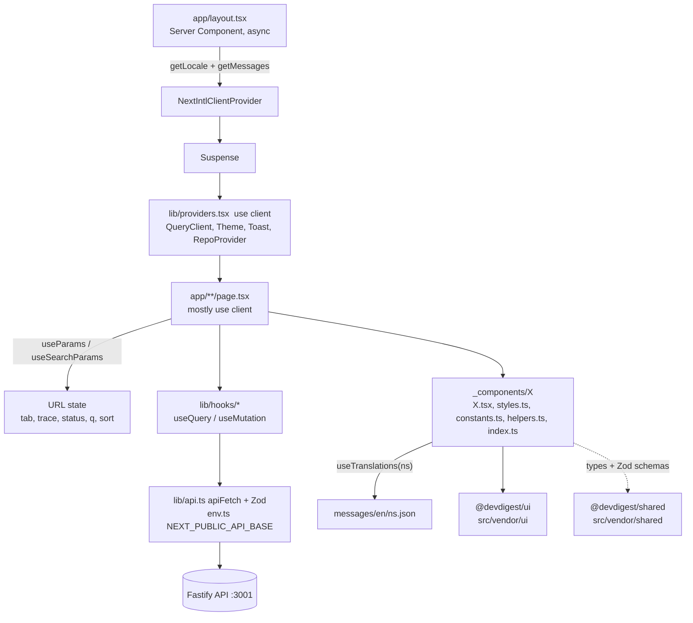

# client — UI architecture

How the Next.js studio is put together: where the Server/Client boundary is, how data reaches
components, where view state lives, and the conventions every component folder follows.
Route-by-route behaviour is in [../specs/pages.md](../specs/pages.md).

## 1. Server vs Client Components

Default in the App Router is Server Component. In this app almost everything is a Client
Component, because screens are driven by TanStack Query hooks, `useSearchParams`, local state and
browser APIs (`EventSource`, `localStorage`, `window.confirm`, keyboard listeners).

| File | Kind | Why |
|------|------|-----|
| `src/app/layout.tsx` | Server (async) | Resolves `getLocale()` / `getMessages()` from `src/i18n/request.ts`, injects the no-flash theme script, mounts `NextIntlClientProvider` and `<Suspense>` around `Providers`. The Suspense is required because descendants call `useSearchParams`. |
| `src/lib/providers.tsx` | `"use client"` | Creates the `QueryClient` (see section 2), `ThemeProvider`, `ToastProvider`, `RepoProvider`. |
| `src/app/agents/page.tsx`, `src/app/settings/[section]/page.tsx` | Server | Thin wrappers that render one client view (`AgentsListView`, `SettingsView`). |
| `src/app/page.tsx`, `onboarding/page.tsx`, `agents/[id]/page.tsx`, `repos/[repoId]/pulls/page.tsx`, `repos/[repoId]/pulls/[number]/page.tsx` | `"use client"` | Read route params / search params, call hooks, redirect (`router.replace`). |
| every component under `_components/` that uses hooks, state or events (`FindingsPanel`, `SeverityFilter`, `FindingsPopover`, `PRRow`, `RunTraceDrawer`, ...) | `"use client"` | Hooks, `useTranslations`, event handlers. |
| `src/lib/hooks/*.ts`, `src/lib/repo-context.tsx`, `theme.tsx`, `toast.tsx` | `"use client"` | They call React hooks. |
| `styles.ts`, `constants.ts`, `helpers.ts`, `index.ts` in component folders; `src/lib/api.ts`, `src/lib/cost.ts`, `src/lib/github-urls.ts` | no directive | Pure modules with no React. They take the boundary of whoever imports them and stay testable without a DOM. |

Rules of thumb:
- Add `"use client"` only to the file that needs it; keep `helpers.ts` / `constants.ts` pure (for example `pulls/_lib/severity.ts#countBySeverity` is shared by `FindingsPopover` on the list and `SeverityFilter` on the detail page — code used by two routes lives in their nearest common ancestor, never in a sibling's `_components`).
- A new route that only composes client views can stay a Server Component (see `agents/page.tsx`).
- Anything calling `useSearchParams` must sit under the `<Suspense>` in `layout.tsx` (already the case).
- Route boundaries: `app/error.tsx` (render crash, inside the intl provider), `app/global-error.tsx` (root layout itself crashed — hardcoded copy, inline styles), `app/not-found.tsx`. Data errors stay inline via each page's `ErrorState`.
- Pages are client components, so titles come from thin per-section `layout.tsx` files (`export const metadata`) on top of the root `title.template` (`"%s · DevDigest"`).

## 2. Data fetching

- **Transport:** `src/lib/api.ts` exports `apiFetch`, the `api.get/post/put/patch/del` helpers, `API_BASE` and `ApiError` (`status`, `code`, `details`). `API_BASE` comes from `src/env.ts` (Zod-validated `NEXT_PUBLIC_API_BASE`, default `http://localhost:3001`) — read env only there. A network failure becomes `ApiError` with status `0` and code `network_error`. A JSON `content-type` is sent only when there is a body.
- **Response validation:** `api.get(path, Schema)` `safeParse`s the body against a `@devdigest/shared` Zod contract; a mismatch throws `ApiError` 502 `invalid_response` with the Zod issues in `details`. Pass a schema for every GET whose contract exists.
- **Keys + options:** each domain file defines a key factory (`repoKeys`, `pullKeys`, `reviewKeys`, …) and `queryOptions` builders (`pullsQuery`, `prRunsQuery`, …). Invalidate through the factory (`reviewKeys.runs(prId)`), never an inline array. Run start/settle invalidation for the PR page is `useRunLifecycle(prId)`.
- **Hooks:** one file per domain in `src/lib/hooks/`, re-exported by name (no `export *`) from `hooks/index.ts`: `core.ts` (settings, secrets, repos, pulls), `agents.ts`, `reviews.ts` (runs, reviews, findings, comments, SSE), `trace.ts`, `repo-intel.ts`. Components never call `fetch` directly.
- **Global behaviour** (`lib/providers.tsx`): queries retry once, `staleTime` 30 s, no refetch on window focus. A failed query toasts only for status `0` or `>= 500` (4xx stay silent so pages show inline empty states). Every failed mutation toasts.

Query keys and what refreshes them:

| Key | Hook | Endpoint | Refreshed by |
|-----|------|----------|--------------|
| `["repos"]` | `useRepos` | `GET /repos` | `useAddRepo`, `useRefreshRepo`, `useDeleteRepo` |
| `["pulls", repoId]` | `usePulls` | `GET /repos/:id/pulls` | `useRefreshRepo`; polls every 60 s and on window focus |
| `["pull", prId]` | `usePullDetail` | `GET /pulls/:id` | cache only |
| `["reviews", prId]` | `usePrReviews` | `GET /pulls/:id/reviews` | `useRunReview`, `useFindingAction`, `useDeleteRun`, `useDeleteReview`, `useRunLifecycle` (settle) |
| `["pr-runs", prId]` | `usePrRuns` | `GET /pulls/:id/runs` | `useDeleteRun`, `useRunLifecycle` (settle); polls 4 s while any run is `running` |
| `["pr-active-runs", prId]` | `usePrActiveRuns` | `GET /pulls/:id/runs/active` | `useRunLifecycle` (start + settle); polls 4 s while non-empty |
| `["run-trace", runId]` | `useRunTrace` | `GET /runs/:id/trace` | none (`retry: false`) |
| `["pr-comments", prId]` | `usePrComments` | `GET /pulls/:id/comments` | `useCreatePrComment` |
| `["agents"]`, `["agent", id]` | `useAgents`, `useAgent` | `/agents`, `/agents/:id` | create, update (also `setQueryData`), delete |
| `["provider-models", p]` | `useProviderModels` | `GET /providers/:p/models` | successful `useTestConnection` |
| `["settings"]`, `["secrets-status"]` | `useSettings`, `useSecretsStatus` | `/settings`, `/settings/secrets-status` | `useUpdateSettings` (`setQueryData`), successful `useTestConnection` |
| `["repo-intel-state", repoId]` | `useRepoIntelStatus` | `GET /repos/:id/index-state` | `useResyncRepoIntel` |

Invalidation after a review run (PR detail page): the live run list comes from the server
(`usePrActiveRuns`), `RunStatus` subscribes to SSE via `useRunEvents` (`EventSource` on
`/runs/:id/events`), and when it reports done `useRunLifecycle().onRunSettled` invalidates
`pr-active-runs`, `pr-runs` and `reviews`. Note that `["pulls", repoId]` is not
invalidated by a run or by accept/reject: the PR list (findings preview, cost) catches up through
its 60 s poll, a window focus, or Refresh.

## 3. URL state

| Param | Where | Values | Written by |
|-------|-------|--------|------------|
| `?tab=` | PR detail | `overview` (default), `findings` (labelled "Agent runs"), `diff` | `setTab` -> `setParam("tab", ...)` in `[number]/page.tsx`; `onRunStart` jumps to `findings` |
| `?trace=` | PR detail | a `run_id`; presence mounts `RunTraceDrawer` | `setParam("trace", id)`; close deletes the param |
| `?status=` | PR list | `all`, `needs_review` (default), `reviewed`, `stale` | `usePullListParams().setStatus`, always written explicitly so `all` sticks |
| `?q=` | PR list | free text (title or number) | `usePullListParams().setQuery`; empty deletes the param |
| `?sort=` | PR list | `newest` (default, omitted), `oldest` | `usePullListParams().setSort` |
| `?tab=` | `/agents/[id]` | `config` | `setTab` in `agents/[id]/page.tsx` |

All writes copy the existing params first and add no history entries. The PR detail uses
`router.replace`; the PR list (`pulls/_lib/usePullListParams.ts`) uses `window.history.replaceState`,
which Next syncs into `useSearchParams` without refetching the dynamic route's RSC payload on every
keystroke. The
repo is taken from the path (`/repos/:repoId/...`) by `RepoProvider`, falling back to
`localStorage["dd-repo"]`, then the first repo. The
severity toggle and "hide low confidence" in `FindingsPanel`, and accordion open state are
component state, not URL state.

## 4. Component folder convention

A component is a folder: `X.tsx` (JSX + hooks), `styles.ts` (style objects, exported as `s`),
`constants.ts`, `helpers.ts` (pure functions), `index.ts` (barrel, the only import point), and an
optional `X.test.tsx` next to it. Page-private components live in a sibling `_components/` folder
(and may nest their own `_components/`, e.g. `RunTraceDrawer/_components/TraceBody`). App-wide
components live in `src/components/<name>/` (`app-shell`, `page-shell`, `diff-viewer`,
`RunCostBadge`, `repo-not-found`, ...). Not every folder has all five files; create a file only
when it has content.

Cross-page reuse is allowed through the barrel: `FindingsPopover` (PR list) imports
`countBySeverity` and `SEVERITY_LEVELS` from `[number]/_components/SeverityFilter`, so list and
detail use the same group-by.

## 5. i18n (next-intl)

Single locale `en`, no locale routing. `src/i18n/request.ts` reads every
`messages/en/<namespace>.json` at request time and merges them into `{ [namespace]: ... }`, so a
feature adds a file without touching shared code. Client components call
`useTranslations("<ns>")`. Namespaces on disk: `prReview` (PR list, findings, severity filter,
timeline, cost), `runs` (trace drawer), `agents`, `settings`, `common`, `shell`, `onboarding` and
others for later lessons. Plural/ICU is used for counts (`list.findings.popoverTitle`).

Not everything is migrated yet: strings in `app/page.tsx`, `onboarding/.../AddRepoView`,
`agents/[id]/page.tsx`, `[number]/page.tsx`, `FindingsTab`, `ReviewRunAccordion`, `PrDetailHeader`
are still literals. New code must use message keys.

## 6. vendor/ui and vendor/shared

- `@devdigest/ui` -> `src/vendor/ui` (barrel `index.ts`): primitives, kit (Drawer, Tabs, Dropdown),
  shell, charts, icons, `SEV` severity tokens, `SETTINGS_SECTIONS`. Always import from the barrel.
  See [../src/vendor/ui/README.md](../src/vendor/ui/README.md).
- `@devdigest/shared` -> `src/vendor/shared`: a COPY of `server/src/vendor/shared` (canonical). Change
  the server first, then mirror. The copies have diverged in places (see INSIGHTS.md), so diff before
  relying on a contract. `PrMeta`, `PrFindingPreview`, `RunSummary`, `RunStats` were mirrored by
  hand for the cost and findings features.
- **Runtime imports work.** `next.config.mjs` sets webpack `resolve.extensionAlias` (`.js` →
  `.ts`/`.tsx`/`.js`), so the Zod schemas of `@devdigest/shared` (NodeNext-style `./contracts/*.js`
  re-exports) can be imported at runtime. Without it `next build` fails with "Module not found"
  while vitest stays green — verify config changes with a production build. See [../INSIGHTS.md](../INSIGHTS.md).
- Two `Severity` types exist: the Zod one (3 levels) and the UI token one (also `INFO`). Key
  per-level UI (`SeverityFilter`, `FindingsPopover`) on the Zod type so `INFO` cannot leak in.

## 7. Cost display

All cost and token numbers go through `src/lib/cost.ts` (`formatCost`, `formatTokenCount`,
`COST_UNKNOWN = "—"`) and, in JSX, `src/components/RunCostBadge` (`variant: "compact"` or
`"withTokens"`, tooltip with the exact 6-decimal value). `null`/`undefined` renders "—", a real
`0` renders `$0.00`. Used by `PRRow` (`PrMeta.cost_usd`), `RunHistory` (`RunSummary.cost_usd`,
settled runs only) and `RunTraceDrawer` > `TraceBody` (`RunStats.cost_usd`, via `formatCost`).
Never format USD inline. Details: [../specs/L01-run-cost-badge.md](../specs/L01-run-cost-badge.md).
