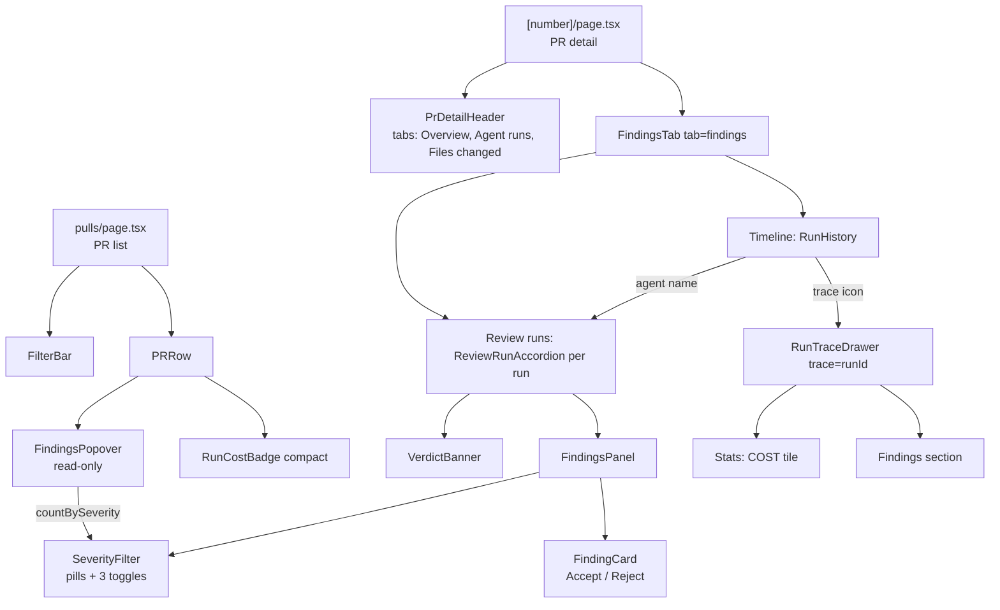

# Pages — behaviour contract per route

Describes what each route of `client/src/app/` does today and the invariants that must stay true
when it changes. Written from the code, not from a mockup. Architecture and conventions:
[../docs/ui-architecture.md](../docs/ui-architecture.md). Cost rules: [L01-run-cost-badge.md](L01-run-cost-badge.md).

Per route: **Data** (hooks and endpoints) · **States** · **Invariants** · **Pinned by** (tests).
Component paths are relative to `src/app/repos/[repoId]/pulls/` unless stated.

## `/` (root redirect)

`src/app/page.tsx`. `useRepos()` (`GET /repos`). Loading: skeleton. Repos exist: `router.replace` to
`/repos/<first>/pulls`. No repos or error: `EmptyState` "No repositories yet" with CTA to `/onboarding`.

## `/onboarding`

`src/app/onboarding/_components/AddRepoView`. **Data:** `useAddRepo` (`POST /repos` with `{ url }`).
**States:** submit disabled while the URL is empty or pending (button reads "Cloning..."); on success
`router.push('/repos/<id>/pulls')`; on failure an inline red box with `ApiError.message` (fallback "Could
not add repository"); the mutation also toasts. Esc or Close/Cancel go to `/`. **Invariants:** only the URL is
collected, API keys live in `/settings/api-keys`. `["repos"]` is invalidated on success so the shell sees
the new repo. **Pinned by:** e2e `06-onboarding.flow.json` (no unit test).

## `/repos/[repoId]/pulls` (PR list)

`pulls/page.tsx`, `PRRow`, `FilterBar`, `FindingsPopover`.

**Data:** `usePulls(repoId)` -> `GET /repos/:id/pulls` returning `PrMeta[]`, polled every 60 s and on window
focus. `useRefreshRepo` (`POST /repos/:id/refresh`) behind the Refresh button. `useRepoNotFound(repoId)`
from `RepoProvider`.

**Filters:** `?status=` (`all`, `needs_review` default, `reviewed`, `stale`), written explicitly. Text search
(title or number) and sort (newest/oldest by `updated_at`) are local state. Header summary: "N open · M need
review", counted over all PRs, not the filtered list.

**Columns** (`COLUMN_KEYS`, grid `GRID` in `constants.ts`, header and rows share it): Pull request, Author,
Size (S < 100, M < 400, else L changed lines), Score, **Findings**, Status, **Cost**, Updated.
- Score: `CircularScore`, or "—" when `PrMeta.score` is null (never reviewed).
- **Findings** renders `FindingsPopover` with `PrMeta.findings` (the findings of the **latest** review run).
  No findings (null/empty) renders "—". Otherwise one compact `SeverityBadge` per level that exists (CRITICAL,
  WARNING, SUGGESTION) with its count. Hovering or focusing the cell opens a read-only popover titled
  "N FINDINGS IN THIS RUN"; each entry is text only: severity badge, title, category, `file:start-end`,
  "NN% confidence", rationale; sorted most severe first, then most confident. No buttons, no accept/reject,
  clicks inside do not navigate. Position is fixed (below the trigger in the upper half of the viewport,
  above it in the lower half, clamped to the viewport) because the table card clips overflow.
  Counts are a client-side group-by (`countBySeverity`), no LLM call.
- **Cost** renders `RunCostBadge compact` with `PrMeta.cost_usd`: the sum over every successful (`done`)
  run of the PR (server-side, `server/src/modules/pulls/routes.ts`), so it covers all runs while Findings covers
  only the latest. `null` renders "—".
- A row click goes to `/repos/:repoId/pulls/:number`.

**States:** loading = 4 skeleton rows; error = `ErrorState` (`ApiError.message`, retry); empty = `EmptyState`
(different body for `all` vs a status); unknown `:repoId` = `RepoNotFound` ("add or pick a repo") instead of
an error.

**Invariants:**
- Cost "—" (unknown) is never shown as "$0.00"; `$0.00` only for a real zero.
- The popover contains no interactive controls; its count equals the number of previews in the payload and
  the severity icons' counts add up to it.
- Findings and Cost come from the list payload only; the row triggers no extra request.
- Header and rows use the same `GRID`; adding a column means changing `COLUMN_KEYS`, `GRID`, the
  `list.columns.*` message and `PRRow` together.

**Pinned by:** `_components/PRRow/PRRow.test.tsx` (COST cell, FINDINGS cell),
`_components/FindingsPopover/FindingsPopover.test.tsx` (dash when empty, hover open/close, read-only, sort,
location format, positioning), `src/components/RunCostBadge/RunCostBadge.test.tsx`, `src/lib/cost.test.ts`.

## `/repos/[repoId]/pulls/[number]` (PR detail)

`[number]/page.tsx` resolves the route number to the PR uuid through the cached pulls list
(`usePulls`), then loads `usePullDetail(prId)` (`GET /pulls/:id`), `usePrReviews`, `usePrRuns`,
`usePrActiveRuns` (see query keys in the architecture doc).

**URL state:** `?tab=overview|findings|diff` (default `overview`); `?trace=<runId>` opens `RunTraceDrawer`
(closing removes it). Starting a review switches to `findings`.

**States:** loading = skeletons; `isError` or missing PR = full-screen `ErrorState` with retry; unknown repo =
`RepoNotFound`. Merged/closed PRs show a banner that a review is informational.

**Tabs** (`PrDetailHeader`): "Overview" (PR description), **"Agent runs"** (`tab=findings`, badge = total
findings across all runs), "Files changed" (`DiffTab`, inline GitHub comments, only on open PRs).

### Agent runs tab (`FindingsTab`)

Top to bottom: live review block while runs are active (`RunStatus` over SSE, Cancel, Open run trace); the
"Lethal Trifecta" banner if any finding has `kind === "lethal_trifecta"`; then two sections.

1. **Timeline** (`RunHistory`, shown if there are runs or commits): every agent run interleaved with the PR's
   commits, newest first. Run row: outcome badge (running / error / cancelled, or for a settled run rejected if
   blockers > 0, reviewed if findings > 0, else approved), score ring, agent name (click opens and scrolls to that
   run's card in Review runs) and `provider/model`, failed-run error line, for settled runs the findings as
   severity icons + counts (`FindingsPopover`, same as the PR list; hover opens "N FINDINGS IN THIS RUN"; data =
   that run's `ReviewRecord.findings`, matched by `run_id` in `FindingsTab`) or the text "N finding(s)" when the run
   has no loaded findings (0 findings, or its review was deleted), then " · M blockers" if > 0,
   time, and for settled (`done`) runs only a cost line `NNNN tok · $0.0013` (`RunCostBadge withTokens`,
   tokens = in + out, unknown cost renders `150 tok · —`). Icons: open trace (`?trace=`), delete run
   (hidden while running, confirm dialog).
2. **Review runs** (`ReviewRunAccordion`, one per `ReviewRecord`, newest first, only the first open by
   default; "No findings yet" `EmptyState` when there are no runs). Header: agent, verdict badge,
   "N findings · M blockers" (blockers = CRITICAL not dismissed), score, time, delete. Expanded body:
   `VerdictBanner` and `FindingsPanel`.

**`FindingsPanel` (per run card).**
- `SeverityFilter` renders (a) a pill row "N CRITICAL · N WARNING · N SUGGESTION", only levels that exist, absent
  when the run has no findings, and (b) three toggle buttons Critical / Warning / Suggestion
  (`aria-pressed`). A level with zero findings is disabled unless it is the active one. Clicking a level lists only
  that severity; clicking it again clears the filter. The selection is local state of that card, so each run filters
  independently and nothing is written to the URL.
- Counts are `countBySeverity(visibleFindings(findings, hideLow))`: a plain group-by on the findings already loaded
  (no LLM call). They ignore the severity selection (so a pill always equals the cards of that level) but follow
  the "Hide low confidence" toggle (confidence < 0.65 hidden) and include accepted/rejected findings.
- Cards are sorted CRITICAL, WARNING, SUGGESTION. Empty result shows "No findings match".
- Keyboard: `j`/`k` move focus, `a` accepts and `d` rejects the focused finding (ignored in inputs).
- `FindingCard` (collapsible; first card open) holds the **Accept** and **Reject** buttons (`useFindingAction` ->
  `POST /findings/:id/accept|dismiss`, then `["reviews", prId]` is invalidated). The persisted state is shown as
  an "accepted" / "dismissed" tag and a muted card. Accept/Reject exist only here; neither the pills, the filter
  buttons nor the list popover have them.

### Run trace drawer (`RunTraceDrawer`)

Opens on `?trace=<runId>`; 720 px drawer with tabs Trace and Live log. Trace tab (`TraceBody`) sections:
Configuration, **Stats** (Duration, Tokens, **COST** via `formatCost(stats.cost_usd)`, Findings), **Findings**
(`FindingsSection`: the run's persisted findings with severity, title, location, rationale, suggested fix;
count badge; same data as that run's Review-runs card), Prompt assembly, Tool calls, Raw output; footer
"Copy raw output". `useRunTrace` -> `GET /runs/:id/trace` (no retry). States: "Loading trace", "no trace" note.
A trace saved before cost tracking renders COST as "—" and must not crash.

**Invariants (PR detail):**
- For a run card with no active filter and "Hide low confidence" off, the sum of the pill counts equals the number
  of finding cards listed and equals the "N findings" in the card header.
- Filtering one run card never changes another card or the Timeline.
- Pill row and filter buttons derive from the Zod `Severity` (3 levels); `INFO` never appears.
- Unknown cost renders "—" in the timeline, the PR list and the drawer.
- Tab and trace state survive reload (URL); severity filter state does not.

**Pinned by:** `_components/SeverityFilter/SeverityFilter.test.tsx` (pills only for existing levels, no row when
empty, select, clear on second click, disabled at zero, `countBySeverity`),
`_components/FindingsPanel/FindingsPanel.test.tsx` (counts match listed cards, filter and restore, empty state),
`_components/FindingCard/FindingCard.test.tsx` (accept/dismiss fire), `_components/RunHistory/RunHistory.test.tsx`
(outcome badge, cost line, failed run has none, severity icons vs count-text fallback), `_components/RunTraceDrawer/RunTraceDrawer.test.tsx` (COST tile,
legacy trace shows "—"), `VerdictBanner.test.tsx`, `RunStatus.test.tsx`, `RunReviewDropdown.test.tsx`;
e2e `04-pr-findings.flow.json`, `05-pr-diff.flow.json`.

## `/agents`

`src/app/agents/page.tsx` (Server) -> `_components/AgentsListView`. **Data:** `useAgents` (`GET /agents`),
`useUpdateAgent` (enable toggle, `PUT /agents/:id`), `CreateAgentModal` (`useCreateAgent`, `POST /agents`).
**States:** loading = 3 skeleton cards; error = `ErrorState` with retry; empty = `EmptyState` with CTA to create;
client-side name filter. Card click goes to `/agents/:id?tab=config`. **Pinned by:** `AgentCard.test.tsx`;
e2e `03-agents.flow.json`.

## `/agents/[id]`

`agents/[id]/page.tsx` (client) + `AgentEditor` with a single **Config** tab (`VALID_TABS = ["config"]`, `?tab=`).
**Data:** `useAgent(id)` (`GET /agents/:id`), `useAgents` for the left list, `useUpdateAgent`,
`useProviderModels` in `ConfigTab` (`GET /providers/:p/models`). **States:** loading = skeletons in the editor pane;
error or no agent = full-screen `ErrorState` with retry; a disabled agent shows a "disabled" badge. Switching agent in
the left list keeps the tab. **Pinned by:** `AgentEditor.test.tsx` (Config fields render).

## `/settings/[section]`

`settings/[section]/page.tsx` (Server) -> `SettingsView`. Sections come from `SETTINGS_SECTIONS` in
`@devdigest/ui`: `api-keys` (default), `models`. Any other key renders a placeholder `EmptyState`.
- **API keys** (`SettingsApiKeys`): `useSecretsStatus` (`GET /settings/secrets-status`, booleans only, never key
  values) and `useTestConnection` (`POST /settings/test-connection`); a successful test invalidates
  `["provider-models"]` and `["secrets-status"]`.
- **Feature models** (`SettingsModels`): `useSettings` / `useUpdateSettings` (`PUT /settings`, writes
  `feature_models`), live model list from `useProviderModels("openrouter")`; features without a choice show a
  "using default" tag and the registry default.
**Invariants:** secrets are never read back into the UI. **Pinned by:** e2e `07-settings.flow.json` (no unit test).
