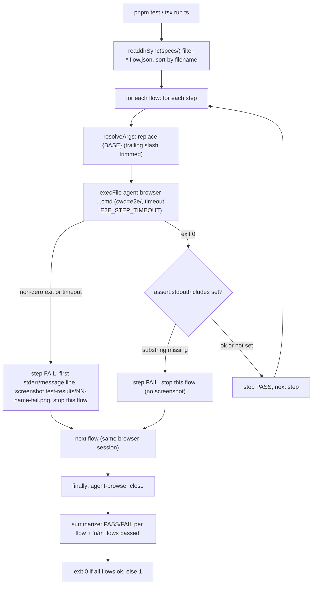

# Flow runner — how `run.ts` executes the flows

The runner is a thin convention over the [agent-browser](https://github.com/vercel-labs/agent-browser)
CLI (Rust + CDP). agent-browser is not a test framework, so `run.ts` adds: spec discovery, `{BASE}`
substitution, one shared browser session, pass/fail bookkeeping and an exit code. No Playwright, no
LLM, no API keys.

Files: `run.ts` (orchestration) · `lib/assert.ts` (types + `resolveArgs`, `stdoutContains`, `summarize`)
· `specs/NN-name.flow.json` (the flows) · `agent-browser.json` (`headed: false`, `ignoreHttpsErrors: false`).



## Loading specs

`loadFlows()` lists `e2e/specs/`, keeps files ending `.flow.json`, sorts lexically and `JSON.parse`s each
as a `Flow` (`{ name, description?, steps[] }`). Run order is therefore the numeric prefix order
(`01-` ... `07-`), which is why numbering must be zero-padded and sequential. Zero matching files prints
`No specs found in ...` and exits 1. There is no schema validation: a malformed JSON file throws and hits
the top-level `main().catch`, which prints `e2e runner crashed: ...` and exits 1.

## Step shape

```jsonc
{ "cmd": ["wait", "--text", "#482"], "label": "seeded PR row visible", "assert": { "stdoutIncludes": "..." } }
```

- `cmd` - argv passed verbatim to `agent-browser` (binary from `AGENT_BROWSER_BIN`). Every arg has
  `{BASE}` replaced by `E2E_BASE_URL` with trailing slashes stripped, so write `"{BASE}/agents"`.
- `label` - log text; defaults to the joined args.
- `assert.stdoutIncludes` - optional extra substring check on the command's stdout. No current flow uses it.

Commands used by the existing flows: `open`, `wait --url`, `wait --text`, `wait --load networkidle`,
`find text <text> click`, `find role button click --name <name>`. The AI `chat` command is never used.

## How assertions work

There is no assertion library. The assertion is the agent-browser command itself:

- `wait --text X` / `wait --url X` poll until the condition holds and exit non-zero if it never does.
- Any non-zero exit (or the runner's per-command `E2E_STEP_TIMEOUT`, default 60000 ms, killing the
  process) rejects `ab()`, which marks the step failed.
- `find ... click` fails if the locator matches nothing, so a click step also asserts presence.
- `stdoutIncludes` is the only runner-side check (`String.includes`, case-sensitive).

A failing step ends **that flow** only; the remaining flows still run. All flows share one agent-browser
daemon session (page state carries over), so every flow starts with its own `open` and does not rely on a
previous flow's page. On an exec failure the runner takes a best-effort `screenshot` to
`e2e/test-results/<NN-name>-fail.png` (git-ignored; CI uploads it). A `stdoutIncludes` failure does not
screenshot.

## Reporting and exit codes

Live log per step (`✓` / `✗ label - message`), then `summarize()`: `PASS|FAIL  <flow name>` lines with the
failing step indented underneath, and a final `n/m flows passed`.

| Exit | Meaning |
|------|---------|
| 0 | every flow passed |
| 1 | at least one flow failed, no specs found, or the runner crashed |

`agent-browser close` always runs in a `finally` to tear down the session.

## Configuration

| Env | Default | Used by |
|-----|---------|---------|
| `E2E_BASE_URL` | `http://localhost:3000` | `run.ts` (`{BASE}`) |
| `AGENT_BROWSER_BIN` | `agent-browser` | `run.ts` |
| `E2E_STEP_TIMEOUT` | `60000` (ms) | `run.ts`, per command |
| `E2E_PG_PORT` / `E2E_API_PORT` / `E2E_WEB_PORT` | `5433` / `3101` / `3100` | `scripts/e2e.sh` |
| `E2E_PG_CONTAINER` / `E2E_PG_IMAGE` | `devdigest-e2e-postgres` / `pgvector/pgvector:pg16` | `scripts/e2e.sh` |

## Two entry points

| Command (in `e2e/`) | What it does | Needs |
|---------------------|--------------|-------|
| `pnpm test` (`tsx run.ts`) | Runs the flows against `E2E_BASE_URL` only | API + web already running on a freshly seeded DB; `agent-browser` installed |
| `pnpm e2e:hermetic` (`../scripts/e2e.sh`) | Boots an isolated stack, runs the flows, tears it down | docker, pnpm, `agent-browser` |

`scripts/e2e.sh` steps: start an ephemeral `pgvector/pgvector:pg16` container (`--rm`, no volume) on
`:5433` and wait for `healthy`; install deps if `node_modules` is missing (server/client via pnpm,
reviewer-core via `npm ci`); refuse to continue unless `DATABASE_URL` points at the isolated port; run
`pnpm db:migrate` then `pnpm db:seed` in `server/`; start the API (`pnpm exec tsx src/server.ts`, `:3101`)
and wait for `/health`; start `next dev -p 3100` with `NEXT_PUBLIC_API_BASE=http://localhost:3101`; export
`E2E_BASE_URL=http://localhost:3100` and run `(cd e2e && npm test)`. A trap on EXIT/INT/TERM kills the
API/web process trees, frees the isolated ports and removes the container, preserving the e2e exit code. It
never touches the dev DB (`:5432`) or the `devdigest_pgdata` volume. CI (`.github/workflows/e2e-web.yml`)
builds its own stack and calls the plain runner, not `scripts/e2e.sh`.

## Why seed data, and why no LLM

The flows read the data written by `server/src/db/seed.ts`: repo `acme/payments-api`, PR `#482` titled
"Add rate limiting to public API endpoints" with files (e.g. `src/config.ts`), one `request_changes` review
with two findings, and the built-in agents. Flows 02/04/05 click the first repo's PR row, so the seeded repo
must be the **only** repo; a dev DB with imported repos breaks them (see the hermetic runner). Flow 01
only needs at least one repo.

Nothing in a flow triggers a model call (no review run, no `chat`, no provider keys): the review shown in
flow 04 is a seeded database row. That is what keeps runs deterministic and key-free - assertions never depend
on model output, timing or cost.
