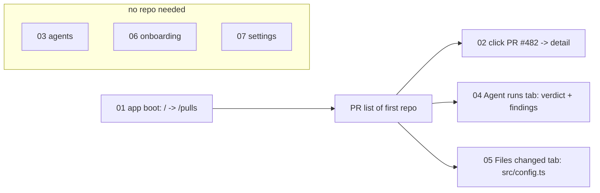

# Flow contracts - flows 01-07

Contract of the browser flows in `e2e/specs/`. These are test flows (JSON), not feature specs; the
runner is described in [../flow-runner.md](../flow-runner.md). Every flow starts with an `open`, uses only
`wait --url|--text|--load` and `find ... click`, and runs against the seed in `server/src/db/seed.ts`.

## Seed data the flows depend on

| Seed item | Value | Used by |
|-----------|-------|---------|
| Repo | `acme/payments-api`, must be the only repo (home redirects to first repo) | 01 (>=1 repo), 02, 04, 05 |
| PR | `#482` "Add rate limiting to public API endpoints" | 02, 04, 05 |
| PR file | `src/config.ts` | 05 |
| Review | verdict `request_changes`, 2 findings (CRITICAL "Hardcoded Stripe secret key in commit", WARNING "N+1 query in user list endpoint") | 04 |
| Agent | `Security Reviewer` (also General Reviewer, Performance Reviewer) | 03 |

## Flows

| # | File | Journey and what it waits for |
|---|------|-------------------------------|
| 01 | `01-app-boot` | `open {BASE}/` -> `wait --load networkidle` -> URL contains `/pulls` -> text `Pull Requests`. Proves client + API + DB are live (redirect only happens with >=1 repo). Order-independent; no seed specifics. |
| 02 | `02-repo-pulls-detail` | `open {BASE}/` -> `/pulls` -> text "Add rate limiting to public API endpoints" -> `find text ... click` -> URL contains `/pulls/482` -> networkidle -> title text again on the detail page. |
| 03 | `03-agents` | `open {BASE}/agents` -> URL `/agents` -> networkidle -> text `Security Reviewer`. |
| 04 | `04-pr-findings` | Open PR #482 as in 02 -> `find role button click --name "Agent runs"` -> URL contains `tab=findings` -> text `request changes` -> text `2 findings` -> text "Hardcoded Stripe secret key in commit". Relies on the newest run accordion being open by default (`FindingsTab` passes `defaultOpen` to the first run). |
| 05 | `05-pr-diff` | Open PR #482 -> `find role button click --name "Files changed"` -> URL contains `tab=diff` -> text `src/config.ts`. |
| 06 | `06-onboarding` | `open {BASE}/onboarding` -> URL `/onboarding` -> text `Add a repository` -> text `Repository URL`. Does not submit (no clone/import). |
| 07 | `07-settings` | `open /settings/api-keys` -> URL -> networkidle -> text `API Keys`; then `open /settings/models` -> URL -> text `Feature Models`. |

Texts are matched against rendered English UI strings (`client/messages/en/*.json`), so renaming a label
or tab breaks the matching flow.

## Rules for adding flow 08+

1. **Sequential numbering**: next free two-digit prefix, `NN-kebab-name.flow.json`; run order is lexical.
2. **Shape**: `{ "name", "description", "steps": [{ "cmd": [...], "label": "..." }] }`. Begin with an `open`
   (the browser session is shared, never assume the previous page). Use `{BASE}`, never a hard-coded origin.
3. **Deterministic assertions only**: `wait --url`, `wait --text`, `find role|text|label`. No `chat`, no step
   that starts a review run, calls a model or needs a key. Assert seeded rows, not generated output.
4. **Read-only**: do not submit forms or mutate backend state (06 deliberately does not submit); flows must
   pass in any order on a freshly seeded DB.
5. **Seed coupling**: if `server/src/db/seed.ts` changes (repo, PR number/title, files, review, findings,
   agents) or a UI label changes, update every flow in the table above that references it, and this file.
6. **No markdown in `specs/`**; docs live here under `docs/`.
7. Verify with `pnpm e2e:hermetic` (a plain `pnpm test` only works on a DB containing just the seed).

## Coverage gaps

Recent UI features with no flow (flows 02/04 only check the PR title, `request changes`, `2 findings` and
the seeded finding title):

- **PR list FINDINGS column** - `FindingsPopover` (severity icons summed over the latest run of each agent;
  hover/focus opens the "N FINDINGS · M AGENTS" preview with one section per agent). Flow 02 clicks the row
  but never asserts the column or popover. Seed review `#482` has no agent, so it shows as "Unknown agent".
- **Per-run severity counters / filter** - `SeverityFilter` pills in each run's `FindingsPanel` in the Agent
  runs tab (local per-run filter). Flow 04 does not click a pill or assert counts.
- **COST column** - `RunCostBadge` (compact) in `PRRow`, header key `list.columns.cost`. Not asserted; the
  seeded review has model `seed` and no run cost, so a flow would need a seed change first.
