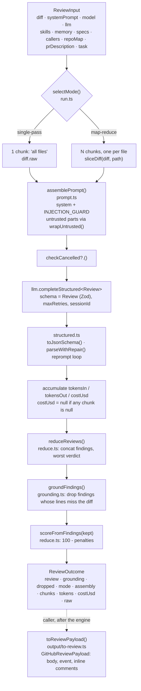

# Review pipeline — architecture and data flow

How `reviewPullRequest` (`src/review/run.ts`) turns a diff into a grounded review.
Behavioural contract and invariants: [../specs/review-contract.md](../specs/review-contract.md).

## Stages

1. **Strategy selection** — `selectMode(strategy, diff, threshold)` in `src/review/run.ts`.
   - `strategy` is `'auto'` (default) | `'single-pass'` | `'map-reduce'`.
   - `'single-pass'` always runs one call over `diff.raw`.
   - `'map-reduce'` runs one call per file, but only when `diff.files.length > 1`; a single-file diff falls back to single-pass.
   - `'auto'` goes map-reduce only when `sum(additions + deletions) > threshold` AND `files.length > 1`. Threshold is `DEFAULT_MAP_THRESHOLD_LINES = 400`, overridable with `mapThresholdLines`.
   - The studio server passes `agent.strategy ?? REVIEW_STRATEGY` (default `single-pass`), so `auto` is opt-in there.
2. **Prompt assembly** — `assemblePrompt()` in `src/prompt.ts` returns `{ messages, assembly }`.
   - System message = agent system prompt + `INJECTION_GUARD` (a module-private constant, appended on every call, so every consumer gets it).
   - The user message holds sections in this order, each omitted when empty: task, `## PR description`, `## Skills / rules`, `## Relevant memory`, `## Repo skeleton`, `## Project context`, `## Callers of changed symbols`, `## Diff to review` (always present).
   - `wrapUntrusted(label, content)` fences content as `<untrusted source="label">…</untrusted>` and rewrites any `</untrusted>` inside the content to `<\/untrusted>`, so content cannot close its own fence. Wrapped: PR description (label `pr-description`), repo map (`repo-map`), specs (`spec-<i>`), callers (`callers`), diff (`diff`).
   - Not wrapped: `skills` and `memory` (treated as trusted or pre-sanitised by the caller) and `task`. The studio server only passes skills that are enabled and, when imported, vetted `clean` (`server/specs/L02-skills.md`); wrapping them would make `INJECTION_GUARD` tell the model to ignore them.
   - PR description is capped at `MAX_PR_DESCRIPTION_CHARS = 4000` before wrapping.
   - `assembly` (a `PromptAssembly`) is the run-trace record. Single-pass keeps the real call's assembly; map-reduce keeps a whole-diff assembly computed up front.
3. **Cancellation** — `checkCancelled?.()` runs before each chunk's LLM call. The engine only calls it; the caller supplies a function that throws.
4. **LLM call, structured output** — `llm.completeStructured<Review>({ model, schema: Review, schemaName: 'Review', messages, maxRetries, sessionId? })`.
   - `maxRetries` defaults to `DEFAULT_REVIEW_MAX_RETRIES = 2`.
   - `toJsonSchema()` (`src/llm/structured.ts`) converts Zod to JSON Schema using `zodResponseFormat` from the `openai` package.
   - `parseWithRepair()` tries `JSON.parse(raw)`, then falls back to `extractJson()` (code fence, then first balanced `{}` / `[]`), then Zod `safeParse`. On failure it returns `repromptMessage` listing the issues.
   - `OpenRouterProvider` (`src/llm/openrouter.ts`) is the only provider shipped here. It uses the OpenAI SDK pointed at `https://openrouter.ai/api/v1`, with a 90 s timeout and 2 SDK retries by default.
   - It sends `response_format: json_schema` with `strict: true`, `temperature` 0 by default, and, for `id === 'openrouter'` only, `session_id` and `usage: { include: true }`.
   - It loops up to `maxRetries + 1` attempts: on a parse failure it appends the assistant output plus the reprompt message and calls again, then throws `OpenRouter structured output failed schema validation…`. It also throws when the response has no `choices`.
   - Tokens are summed across attempts. `costUsd` is the API-reported `usage.cost` if present, else the injected `estimateCost(model, in, out)`, else `null`.
   - Only `completeStructured` and `listModels` work; `complete` and `embed` throw.
5. **Aggregation** — per chunk: `tokensIn` / `tokensOut` are summed. `costUsd` starts at `0` and becomes `null` as soon as any chunk returns `null`, and stays `null`. It is never coerced to 0.
6. **Reduce** — `reduceReviews()` (`src/review/reduce.ts`): one partial is returned as is. Otherwise findings are concatenated, the verdict is the worst (`request_changes` > `comment` > `approve`), the score is the rounded mean, and summaries are joined with a space. The score and verdict from this step are provisional.
7. **Grounding gate** — `groundFindings(findings, diff)` (`src/grounding.ts`).
   - `buildLineIndex` maps each file to its set of new-side line numbers, from `hunk.newLineNumbers` or else `newStart .. newStart + max(newLines, 1) - 1`.
   - A finding is dropped when its file is not in the diff, or when `[start_line, end_line]` (order-normalised) shares no line with that file's index.
   - Findings with `kind` in `secret_leak`, `lethal_trifecta`, `phantom`, `hook` only need their file to be in the diff.
   - The result is `{ kept, dropped: [{ finding, reason }] }`, and `groundingSummary` renders `"<kept>/<total> passed"`.
8. **Score** — `scoreFromFindings(kept)`: `100 - Σ penalty`, clamped to 0..100, with penalties `CRITICAL 35`, `WARNING 12`, `SUGGESTION 3`. The model's own `score` and `verdict` are not used for the final score.
9. **Outcome** — `{ review: { ...merged, findings: kept, score }, grounding, dropped, mode, assembly, chunks: [{ label }], tokensIn, tokensOut, costUsd, raw }`. `raw` is the chunks' raw outputs joined with `\n---\n`. Note that `review.verdict` is still the model's (or the worst across chunks), not recomputed.
10. **GitHub payload (separate call)** — `toReviewPayload(review, { inline, title, failOn, diff })` in `src/output/to-review.ts`; `reviewPullRequest` does not call it.
    - The event is deterministic: no findings gives `APPROVE`; `gateTriggered(findings, failOn)` gives `REQUEST_CHANGES`; otherwise `COMMENT`. The model verdict is ignored.
    - `failOn` is `never` | `critical` (default) | `warning` | `any`, ranked via `FAIL_ON_MIN_RANK`. `countBlockers` counts findings at or above that rank.
    - Inline comments anchor to the in-diff line nearest `end_line` within the finding's range. If the diff is not supplied, the raw `end_line` is used. If no line resolves, the comment is dropped and the finding stays in the body.

## Events

`onEvent({ kind: RunEventKind, msg, data? })` fires for the mode choice (`info`), each chunk start (`tool`), each chunk result (`result`), the reduce result, every grounding drop (`info`) and the grounding summary (`result`).

## Purity rule

No DB, filesystem, GitHub, or env access in `src/`. The only side effect is the injected `LLMProvider.completeStructured` call. Anything that needs I/O (skill bodies, memory, specs, repo map, PR description) is resolved by the caller and passed in as strings. Pricing is also injected (`estimateCost` on `OpenRouterProvider`), so there is no price table in the engine. `OpenRouterProvider` does perform network I/O, but only through the OpenAI SDK and `fetch` in `listModels`; it is an adapter the caller chooses to construct, not something `reviewPullRequest` imports.

## How consumers import it

There is no build and no emitted JS (`pnpm build` is `tsc --noEmit`). Consumers use a path alias to the source, as the server does:

- `server/tsconfig.json`: `"@devdigest/reviewer-core": ["../reviewer-core/src/index.ts"]`
- `server/vitest.config.ts`: alias to `../reviewer-core/src`

A new consumer must add the alias to both its `tsconfig.json` and `vitest.config.ts`. In this package, `@devdigest/shared` resolves to `../server/src/vendor/shared` (tsconfig `paths` and `vitest.config.ts`), and `zod` is pinned to this package's own `node_modules`. The server re-exports engine functions through thin shims in `server/src/platform/{grounding,prompt,structured}.ts` and calls `reviewPullRequest` from `server/src/modules/reviews/run-executor.ts`.
