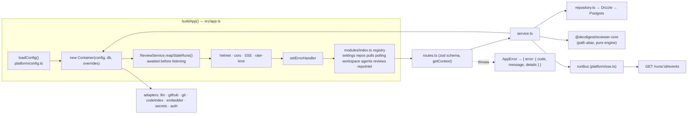

# server — architecture

How the API is wired and how a request moves through it. Companion to the package
[README](../README.md) (API map, env vars) and the behaviour spec
[review-flow](../specs/review-flow.md).



## Composition root: `Container`

`src/platform/container.ts` is the only place that decides which concrete adapter is
used. `buildApp({ config?, db?, overrides? })` creates exactly one `Container` per app
instance and attaches it as `app.container` (typed via `declare module 'fastify'` in
`app.ts`). Every module plugin reads `const { container } = app` and builds its
service from it (`new ReviewService(container)`).

What the container holds:

| Member | Resolution |
|---|---|
| `config`, `db`, `secrets`, `auth`, `jobs`, `runBus` | built in the constructor (`secrets` = `LocalSecretsProvider(config.secretsPath)`, `auth` = `LocalNoAuthProvider(db)`, `jobs` = `new JobRunner(db)`, `runBus` = the module-level singleton from `platform/sse.ts`) |
| `git`, `codeIndex`, `repoIntel`, `depgraph`, `tokenizer`, `priceBook` | lazy getters, memoised on first use |
| `agentsRepo`, `reviewRepo` | lazy shared repositories, so a module never imports another module's folder |
| `github()`, `llm(id)`, `embedder()` | async, because they need a secret; `llm()` caches per provider id in `llmCache` |

Rules that follow from this:

- Services never `new` an adapter; they ask the container. `llm('openrouter')` builds
  `OpenRouterProvider` from `@devdigest/reviewer-core` and injects `priceBook.estimate`
  so cost uses live OpenRouter prices with the static `estimateCost` table
  (`adapters/llm/pricing.ts`) as fallback.
- A missing key throws `ConfigError` (HTTP 500, code `config_error`) at resolve time,
  not at boot, so the app starts with zero keys. In a review run this surfaces as a
  `failed` run with the message, not a crashed request.
- `embedder()` throws `ConfigError` when `EMBEDDINGS_ENABLED` is false, before any
  OpenAI client exists: zero OpenAI calls by default. Callers catch and degrade.
- After a key is changed through Settings, `invalidateSecretCaches()` clears
  `llmCache`, `_github` and `_embedder` so the next resolve picks up the new secret.

### Test overrides

`ContainerOverrides` mirrors the adapter ports: `secrets`, `auth`, `github`, `git`,
`codeIndex`, `embedder`, `llm` (a partial map keyed by `'openai' | 'anthropic' | 'openrouter'`),
`repoIntel`, `depgraph`, `tokenizer`. An injected value always wins over the real one.
The doubles live in `src/adapters/mocks.ts` (`MockLLMProvider`, `MockGitClient`,
`MockGitHubClient`, `MockCodeIndex`, `MockEmbedder`, `MockAuthProvider`,
`MockSecretsProvider`), all deterministic and network-free. Example from
`test/reviews.it.test.ts`:

```ts
buildApp({ config, db: pg.handle.db, overrides: {
  embedder: new MockEmbedder(),
  git: new MockGitClient({ diff: DIFF }),
  llm: { openai: new MockLLMProvider('openai', { structured }) },
}});
```

`MockLLMProvider.completeStructured` validates the fixture against the requested
schema and returns `tokensIn: 100, tokensOut: 50, costUsd: 0.001` per call. That fixed
price is what lets a test assert `cost == calls x 0.001` (see
[review-flow](../specs/review-flow.md#invariants)).

### Secrets

Secrets are never read from `process.env` by feature code. The one read chokepoint is
`LocalSecretsProvider` (`adapters/secrets/local.ts`): a value stored in the JSON file
(`config.secretsPath`, written with mode `0600` by `set()`) wins; otherwise it falls
back to `process.env`. `GITHUB_TOKEN` is canonical, `GITHUB_PAT` is accepted as a
fallback. `SecretsProvider` is an interface in `@devdigest/shared`, so a vault backend
can replace it without touching call sites. Secrets are deliberately not part of
`AppConfig`.

## Module layering

Each feature is a Fastify plugin `src/modules/<name>/routes.ts`, registered statically
in `src/modules/index.ts` (one import + one entry). Static registration, not
filesystem autoload, because the same code must run under `tsx`, the bundler and
vitest, and native dynamic `import()` of `.ts` files is not portable.

```
routes.ts      HTTP only: zod params/body schema, getContext(), call the service, shape the reply
service.ts     orchestration + business rules; gets adapters/repos from the Container
repository.ts  the only layer that touches Drizzle for that domain
```

- `getContext(container, req)` (`modules/_shared/context.ts`) resolves
  `{ workspaceId, userId }` through `AuthProvider`. With `LocalNoAuthProvider` it is
  always the default workspace, but every query still scopes by `workspaceId` so
  multi-tenancy does not need a rewrite.
- `IdParams` (`modules/_shared/schemas.ts`) validates `:id` as a uuid, so a bad id is
  a 422 rather than a database error.
- Routes use `app.withTypeProvider<ZodTypeProvider>()`: the Zod contracts from
  `src/vendor/shared` are both the request validator and the response serializer.
- The reviews repository is split by aggregate under `modules/reviews/repository/`
  (`review.repo.ts`, `run.repo.ts`, `pull.repo.ts`); `ReviewRepository` composes them
  so its public API stays one class.
- Not every route follows the full stack. `modules/pulls/routes.ts` queries
  `container.db` directly (list/detail, GitHub sync, rollups) and has no service or
  repository file. Treat it as the exception, not a template for new modules.
  The same holds for the `settings`, `polling` and `workspace` routes.

### Enforcement

The layering is checked by dependency-cruiser (`.dependency-cruiser.cjs`, run by
`pnpm arch:check` and by `test/architecture.test.ts` inside `pnpm test`): only
`repository*` files import Drizzle/`src/db`, modules never import `src/adapters/*`
or another module, SDKs and `fs` stay in adapters, adapters and `platform/*` (except
the container) never import modules, and `src/vendor/shared` stays dependency-free.
The baseline `.dependency-cruiser-known-violations.json` is empty (the 31 violations
that predated the check were fixed on 2026-10-18), so any violation fails the check. Rules,
rationale and the baseline policy: the `onion-architecture` skill
(`.claude/skills/onion-architecture/`).

## Errors

`platform/errors.ts` defines `AppError(code, message, statusCode = 400, details?)` and
`NotFoundError` (404 `not_found`), `ValidationError` (422), `ExternalServiceError`
(502), `ConfigError` (500). Throw these from services; never build an error response
by hand. The single `app.setErrorHandler` in `app.ts` maps, in order:

1. zod request validation failure (`hasZodFastifySchemaValidationErrors`) → 422
   `validation_error` with `details`.
2. response serialization failure (`isResponseSerializationError`) → logged, generic
   500 `internal_error` (the raw object is never leaked).
3. any `ZodError`, matched by `instanceof` **or** by shape (`name === 'ZodError'` plus
   `issues`/`errors`), because `instanceof` fails across duplicate zod instances
   (shared vs api) → 422. This catches service-level `.parse()` calls.
4. `AppError` → its `statusCode` with `{ error: { code, message, details } }`.
5. anything else → logged, code `internal_error`. A framework 4xx (rate limit, bad JSON,
   body too large) keeps its status and message; everything else becomes 500 with the
   generic message `Internal error`, so SQL or filesystem details never reach the client.

The handler is registered before the modules so the encapsulated module plugins
inherit it. Health routes: `/health` (liveness) and `/health/ready` (`select 1`, 503 on
failure); both are exempt from rate limiting.

## Run bus, SSE and jobs

Two different async mechanisms exist; do not confuse them.

**`RunBus` (`platform/sse.ts`)** is an in-memory, per-process pub/sub for run logs.
`publish(runId, kind, msg, data)` stamps a monotonically increasing `seq` and a
wall-clock `t`, appends to a per-run buffer and emits to live subscribers.
`subscribe()` replays the whole buffer first, then streams live, which is what makes a
late or reconnecting client see the full log. `complete(runId)` marks the run done,
clears its cancel flag and drops the emitter; `onDone()` fires immediately for an
already-completed run so a late subscriber ends instead of hanging. `cancel()` /
`isCancelled()` carry the cancellation signal to the runner. The route
`GET /runs/:id/events` (`modules/reviews/routes.ts`) bridges the bus to an async
generator for `fastify-sse-v2`, one frame per event: `id = seq`, `event = kind`,
`data = JSON(RunEvent)`.

`RunLogger` (`platform/run-logger.ts`) is the single sink a run writes to. One call
fans out to the bus (live), the bus buffer (later persisted as `run_traces.trace.log`)
and pino. It can target several runIds at once, which is how shared pre-work (diff load)
shows up in every agent's log.

**`JobRunner` (`platform/jobs.ts`)** is a `p-queue` (concurrency 3) mirrored into the
`jobs` table with a timeout (120 s) and retries (2). It is used for clone, PR import,
indexing and resync (`modules/repos/service.ts`, `modules/repo-intel/*`). Review runs do
**not** use it: `ReviewService.runReview` creates the `agent_runs` rows, then calls
`void this.executor.executeRuns(...)` (fire-and-forget) so `POST /pulls/:id/review`
returns the runIds immediately and the client subscribes to SSE. The trade-off is that a
review has no queue, retry or `jobs` row; its only durability is the `agent_runs` row,
which is why boot reaping exists.

Known limits of the bus (read from the code, not hypothetical): buffers, `seq` and
`completed` entries are never freed after `complete()`, and the state is per process, so
it assumes a single API instance (the same assumption as the boot reaper).

## How reviewer-core is consumed

`@devdigest/reviewer-core` is a sibling package, not an npm dependency. It is reached
only through the path alias, declared in **both** `server/tsconfig.json`
(`"@devdigest/reviewer-core": ["../reviewer-core/src/index.ts"]`) and
`server/vitest.config.ts` (`alias → ../reviewer-core/src`). A new alias must be added to
both.

The boundary: `reviewPullRequest()` is pure (diff + resolved prompt inputs + an injected
`LLMProvider` → grounded `Review`, tokens, `costUsd`). It does no DB, GitHub, fs or
persistence. The server side of the line, in
`modules/reviews/run-executor.ts`, only:

1. resolves context: loads the diff (`diff-loader.ts`), the LLM via `container.llm()`,
   repo-intel digests (callers, repo map, rank note) as plain strings;
2. calls `reviewPullRequest({ ..., onEvent, checkCancelled })`, wiring `onEvent` to
   `RunLogger` and `checkCancelled` to `runBus.isCancelled`, throwing its own
   `RunCancelledError` (the engine stays agnostic about the error type);
3. persists `reviews`, `findings`, `agent_runs`, `run_traces`, and streams events.

Consequently grounding (`platform/grounding.ts` is a re-export shim of
`groundFindings`/`groundingSummary`), score computation and blocker counting are
reviewer-core's job and must not be re-implemented in the server. Review logic changes
belong in `reviewer-core`; the server only resolves context, persists and streams.

## Database and migrations

- Schema: `src/db/schema.ts` is a barrel over `src/db/schema/*.ts`. It already contains
  every table of the course; tables for later lessons stay empty until used.
- Migrations: edit the schema, then `pnpm db:generate` (drizzle-kit, config in
  `drizzle.config.ts`, output `src/db/migrations/`), then `pnpm db:migrate`
  (`src/db/migrate.ts` → `runMigrations(url)`, which first runs
  `CREATE EXTENSION IF NOT EXISTS vector`).
- **Never hand-edit `src/db/migrations/`.** The drizzle journal (`meta/`) has needed a
  manual repair before; hand-added SQL breaks it (see INSIGHTS.md, "What Doesn't Work").
- **Migrations are not applied on boot.** `buildApp` only reads/writes rows. A
  "relation ... does not exist" error means `pnpm db:migrate` was skipped. Tests get a
  migrated database from `test/helpers/pg.ts` (`startPg()` runs `runMigrations` against a
  `pgvector/pgvector:pg16` testcontainer), which is why DB-backed files must be named
  `*.it.test.ts` and self-skip without Docker.
- Boot does exactly one write: `reapStaleRunningRuns` (see the review-flow spec).
