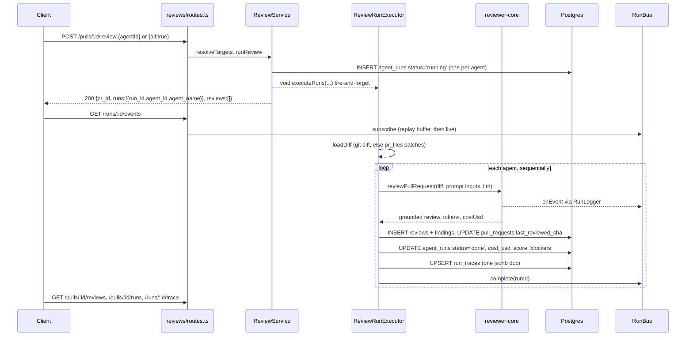
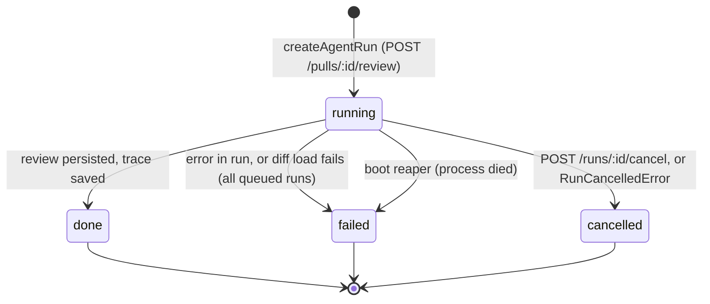

# Review flow — behaviour spec (server)

Contract of the full review cycle as implemented today: trigger, background run,
persistence, streaming and reads. Architecture background:
[architecture.md](../docs/architecture.md). Code: `src/modules/reviews/*`,
`src/platform/sse.ts`, `src/platform/run-logger.ts`, engine in `reviewer-core/src/review/run.ts`.

## Goal
One manual trigger produces, per agent, a grounded review that is persisted, observable
live, and still inspectable after a reload or a failure.

## Scope
**In:** `POST /pulls/:id/review`, the background run, SSE, run history/trace reads, cancel,
delete, boot reaping, finding accept/dismiss.
**Out:** prompt content (reviewer-core), repo-intel indexing, CI runs (`ci_runs`), GitHub
posting of reviews.

## Sequence

## Endpoints (all in `modules/reviews/routes.ts`)

| Method + path | Behaviour |
|---|---|
| `POST /pulls/:id/review` | Body `RunRequest` (`agentId` or `all: true`, parsed with `RunRequest.parse(req.body ?? {})`). Rate limit 10/min. `all` = `agentsRepo.listEnabled`; unknown `agentId` = 404; neither = `AppError('invalid_run_request', ..., 400)`. Unknown PR/repo = 404. Returns immediately: `{ pr_id, runs, reviews: [] }`. |
| `GET /runs/:id/events` | SSE, no rate limit. Replays the buffer, streams live, ends on `complete`. Frame: `id=seq`, `event=kind` (`info`/`tool`/`result`/`error`), `data=JSON(RunEvent)`. |
| `GET /pulls/:id/runs/active` | Runs with `status='running'` for the PR (`run_id, agent_id, agent_name, ran_at`). |
| `GET /pulls/:id/runs` | All runs of the PR, any status, newest first (`RunSummary`, includes `cost_usd`, `score`, `blockers`, `error`). |
| `GET /runs/:id/trace` | The `run_traces` document; 404 `Run trace not found` if none. |
| `GET /pulls/:id/reviews` | Persisted reviews with findings, newest first, with `agent_name`. |
| `POST /runs/:id/cancel` | See cancellation below. |
| `DELETE /runs/:id` | Deletes the run's `reviews` rows (findings cascade), then the `agent_runs` row (`run_traces` cascades). |
| `DELETE /reviews/:id` | Deletes one review and its findings; 404 if not in workspace. |
| `POST /findings/:id/(accept\|dismiss)` | Sets `accepted_at` / `dismissed_at` and clears the other; 404 if the finding's PR is in another workspace. |

## Run state machine (`agent_runs.status`)

Per-transition data (`run.repo.ts › completeAgentRun`, `run-executor.ts`):

| Outcome | status | cost_usd | score | blockers | error | `run_traces` | reviews/findings |
|---|---|---|---|---|---|---|---|
| success | `done` | `outcome.costUsd` (may be null) | grounded score | `countBlockers(kept, agent.ciFailOn)` | null | full trace | inserted |
| run error | `failed` | null | null | null | message | minimal trace, `log` = bus buffer | none |
| cancel (runner) | `cancelled` | null | null | null | `Cancelled by user` | minimal trace | none |
| diff load failed | `failed` for **every** queued run | null | null | null | `Failed to load PR diff: ...` | minimal trace | none |
| reaped on boot | `failed` | unchanged | unchanged | unchanged | not set | none written | none |

Notes on the table:
- `completeAgentRun` writes `costUsd ?? null`, `score ?? null`, `blockers ?? null`,
  `error ?? null`; omitting a field therefore clears it.
- A failed/cancelled run still stores `grounding = '0/0 passed'`, `findings_count = 0`,
  tokens `0`.
- Agents in one POST run **sequentially**, in the order of `targets`; one agent failing
  does not stop the next. Each run is isolated: its own `agent_runs` row, review, trace.
- The runner reaches `done` only after `reviews`, `findings`, `markReviewed` and the
  `agent_runs` update succeeded; `run_traces` is saved after that, then `runBus.complete`.
  `runBus.complete` is always called on every terminal path.
- `markReviewed(prId, headSha)` stamps `pull_requests.last_reviewed_sha` on success; the PR
  list derives `needs_review` / `reviewed` / `stale` from it (`modules/pulls/status.ts`).

### Cancellation
`ReviewService.cancelRun` publishes an info event, calls `runBus.cancel(runId)`, runs
`cancelRunIfRunning` (`UPDATE ... SET status='cancelled' WHERE id=? AND status='running'`),
then `runBus.complete`. The live runner checks `runBus.isCancelled` through `checkCancelled`,
which reviewer-core calls **before each chunk's LLM call**. Two consequences of the current
code, worth knowing before changing it:
- The DB row flips immediately, so cancel also works for orphaned runs with no runner.
- With the default `single-pass` strategy there is one chunk and so one checkpoint. A cancel
  that arrives after that call started is not observed by the engine; `completeAgentRun`
  has no status guard, so the finishing runner can overwrite `cancelled` with `done`.
  No test covers this path.

## Persistence contract
- `agent_runs` (`db/schema/runs.ts`): `id` = runId, `workspace_id`, `agent_id`, `pr_id`,
  `provider`, `model`, `status`, `error`, `duration_ms`, `tokens_in`, `tokens_out`,
  `cost_usd` (double, nullable), `findings_count`, `grounding` (`"kept/total passed"`),
  `score` (int), `blockers`, `source` (`local`), `ran_at`.
- `reviews` (`db/schema/reviews.ts`): `kind='review'`, `run_id` (no FK to `agent_runs`,
  which is why `deleteAgentRun` removes the review explicitly), `verdict`, `summary`, `score`,
  `model`. `findings` cascade from `reviews`.
- `run_traces`: PK `run_id` → `agent_runs` (cascade), one jsonb `trace` (`RunTrace`:
  `config`, `stats{duration_ms,tokens_*,cost_usd,findings,grounding}`, `prompt_assembly`,
  `tool_calls`, `raw_output`, `log`). Upserted by `saveRunTrace`.
- Diff source (`diff-loader.ts`): `git diff base...head` via `container.git`; if that throws
  or is empty, a synthetic diff is rebuilt from `pr_files.patch`.
- Strategy: `agent.strategy ?? REVIEW_STRATEGY` where the studio default is `'single-pass'`
  (`reviews/constants.ts`): one call for the whole diff.

## Invariants

Each must stay true; the pinning test is listed where one exists.

1. **Score comes from grounded findings.** `reviewPullRequest` returns
   `score = scoreFromFindings(ground.kept)`; the model's own `score` is ignored and the
   persisted `reviews.score` and `agent_runs.score` are that value. Pinned by
   `test/reviews.it.test.ts` › "runs a review: ... grounding drops the hallucinated finding"
   (fixture score 42, one CRITICAL kept, expects `65`); grounding rules by
   `test/grounding.test.ts` and `test/adapters.test.ts` › "structured review pipeline".
2. **Only grounded findings are persisted.** Findings that cite a line/file outside the diff
   are dropped before insert; `findings_count` and `grounding` (e.g. `1/2 passed`) reflect
   that. Pinned by the same `reviews.it.test.ts` case (`findings` length 1, `grounding === '1/2 passed'`).
3. **Cost: `null` is unknown, `0` is free; never coerce.** `costUsd` is stored as returned
   by the engine, which yields `null` if any chunk's model is unpriced. Failed/cancelled runs
   store `null`. Pinned in `reviews.it.test.ts` (stored cost == calls x `0.001`, trace
   `stats.cost_usd` identical, timeline and PR list agree); `RunStats` accepting `null` and
   absent `cost_usd` by `test/contracts.test.ts`; unknown-model pricing returns `null` by
   `test/adapters.test.ts` › "pricing / cost discipline". There is no test for a failed run
   storing `null`.
4. **No extra model calls for cost.** Cost is read from the calls already made; the
   `reviews.it.test.ts` equality above is the proof.
5. **One trace document per run**, keyed by `run_id`, present for done, failed and cancelled
   runs so the reason survives a reload. Pinned for `done` by `reviews.it.test.ts`
   (`/runs/:id/trace`: `config.model`, `stats.grounding`, non-empty `log`). The failed/cancelled
   trace is not covered by a test.
6. **A runId exists before any work starts.** `createAgentRun` runs synchronously inside the
   POST, so the client can subscribe to SSE immediately. Pinned by the SSE case in
   `reviews.it.test.ts` (`/runs/:id/events` returns `text/event-stream` with replayed
   `Starting review` and `Citation grounding`).
7. **SSE is replay-first and always terminates for a completed run.** Late subscribers get
   the buffer, then the stream ends (`RunBus.onDone` fires for completed runs). Same test.
8. **Stuck `running` runs are marked `failed` on boot**, awaited in `buildApp` before any
   plugin or route is registered (so a new run can never be reaped by accident). Single
   API instance per DB is assumed. **No test pins this**; any change to `reapStaleRunningRuns`
   or the call order in `app.ts` needs one (an `*.it.test.ts` that seeds a `running` row,
   calls `buildApp`, and reads the status back).
9. **Workspace scoping:** every read/write goes through `getContext` and filters by
   `workspace_id` (finding actions check `pull.workspaceId`).
10. **Finding actions are exclusive:** accept clears `dismissed_at`, dismiss clears
    `accepted_at`. Pinned by "finding actions: accept, dismiss".
11. **Hermetic tests:** only `*.it.test.ts` files may import `test/helpers/pg.ts` or touch a
    DB. They self-skip when Docker is absent, so a green `pnpm test` may not have run
    them; check the output after touching SQL or routes. Background runs are awaited in tests
    with `waitForPrRuns` (`test/helpers/runs.ts`), never with sleeps.

## Related read: PR list rollup
`GET /repos/:id/pulls` (`modules/pulls/routes.ts`) derives `score` from the latest
`kind='review'` review, `findings` from that review, and `cost_usd` as the sum over the
PR's `done` runs. See [L01-run-cost-badge.md](L01-run-cost-badge.md#update-2026-10-17).

## Acceptance criteria
1. `POST /pulls/:id/review` returns within one request with one `run_id` per target agent and
   `reviews: []`; reviews appear later via `GET /pulls/:id/reviews`.
2. After a run reaches a terminal status, `agent_runs`, `run_traces` and (on success) `reviews` +
   `findings` agree with the table above.
3. `pnpm typecheck && pnpm test` green with Docker up so `*.it.test.ts` actually run.

## Open points / deviations
- Cancel vs single-pass checkpoint, and `done` overwriting `cancelled` (see Cancellation).
- Boot reaper sets only `status='failed'`: no `error` text and no trace is written for reaped runs.
- `RunBus` never frees per-run buffers, and `GET /runs/:id/events` for a run from a previous
  process (never completed in this one) waits until a `complete` that will not arrive.
- No test for reaping, cancellation, failed-run persistence or a null-cost run.
- `reviews.it.test.ts` titles its main case "map-reduce" and the SSE case says "The run is
  synchronous"; both are stale: the default strategy is `single-pass` and runs are background.
